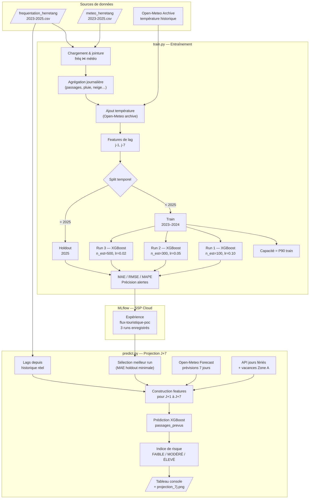

# Pipeline ML — Anticipation de fréquentation touristique

**Hackathon DGE — Gestion des flux touristiques | Équipe 2 | 9–10 novembre 2026**

---

## Vue d'ensemble

Le pipeline prédit la fréquentation journalière d'un site touristique à horizon J+7 et dérive un **indice de risque de sur-fréquentation** (faible / modéré / élevé) permettant aux gestionnaires de passer d'une gestion réactive à proactive.

Le POC est instancié sur le site **Herretang — Tuilerie** (Isère) avec les données réelles de l'éco-compteur piéton 2023–2025.

```
Éco-compteurs (horaire)   ─┐
Météo historique           ├─► (données fournies) ─► 2 CSV horaires
Calendrier officiel       ─┘

2 CSV horaires   ─► train.py ─► 3 modèles XGBoost tracés dans MLflow

Meilleur modèle MLflow ─┐
Météo prévisionnelle    ├─► predict.py ─► Indice de risque J+7 (JSON)
Calendrier live        ─┘
```

### Flowchart détaillé



---

## Données d'entrée

### Fréquentation — éco-compteur ENS (SSP Cloud)

| Propriété | Valeur |
|---|---|
| Site | `100040825` — Herretang |
| Canal | `353347292` — piéton IN (Tuilerie) |
| Compteur | `X2I21055989` |
| Couverture | 2023-01-01 → 2025-12-31 (1 096 jours) |
| Granularité | Horaire |
| Lignes | 26 304 |
| Passages valides | 37 626 |
| Anomalies | 3 créneaux manquants (changements d'heure d'automne) |

### Météo — Open-Meteo

- **Historique** : API `archive-api.open-meteo.com/v1/archive`
  - Variables : `precipitation`, `snowfall` (horaires), `temperature_2m_mean` (journalière)
  - Coordonnées de grille retournées : 45.3779 N, 5.6338 E
- **Prévisionnel** : API `api.open-meteo.com/v1/forecast`
  - Variables : `temperature_2m_mean`, `precipitation_sum`, `precipitation_hours`, `snowfall_sum`
  - Horizon : 7 jours

### Calendrier officiel

| Source | Contenu |
|---|---|
| `calendrier.api.gouv.fr` | Jours fériés métropolitains |
| `data.education.gouv.fr` — `fr-en-calendrier-scolaire` | Vacances scolaires Zone A (académie Grenoble), population élèves |

---

## Étape 1 — Préparation des données (`preparer_donnees.py`)

Produit deux fichiers CSV reproductibles à partir des archives brutes.

### Traitements

1. **Lecture des archives ZIP annuelles** (2023, 2024, 2025) depuis SSP Cloud ; extraction du canal `353347292` uniquement.
2. **Alignement UTC** : toutes les horodatations sont converties en UTC pour éviter l'ambiguïté lors des changements d'heure.
3. **Qualification** : chaque créneau est marqué `valide`, `manquante` (valeur absente) ou `invalide` (valeur non entière / négative / infinie).
4. **Enrichissement calendrier** : chaque créneau reçoit `weekend`, `jour_ferie`, `vacances_scolaires_zone_a` et les libellés associés.
5. **Jointure météo** : précipitations et neige sont alignées sur le même `debut_utc` (Open-Meteo étiquette les cumuls à la fin de l'heure suivante, ce qui est corrigé).

### Contrôles d'intégrité

```
✓ 26 304 créneaux horaires (2 × 8 760 h pour 2023 et 2025 + 8 784 h pour 2024 bissextile)
✓ Clé debut_utc unique dans les deux fichiers et identique entre eux
✓ Couverture intégrale de 1 096 jours
✓ Total des passages valides : 37 626
✓ Correspondance météo complète (zéro créneau sans données météo)
✓ Pagination complète du calendrier scolaire
```

### Sorties

| Fichier | Colonnes clés |
|---|---|
| `frequentation_herretang_2023_2025.csv` | `debut_utc`, `date`, `heure`, `passages_entrants`, `qualite_frequentation`, `weekend`, `jour_ferie`, `vacances_scolaires_zone_a` |
| `meteo_herretang_2023_2025.csv` | `debut_utc`, `precipitations_mm`, `precipitation_oui_non`, `neige_tombee_cm`, `neige_oui_non` |

---

## Étape 2 — Entraînement (`train.py`)

### Préprocessing

```
Données horaires
      │
      ▼
Filtre qualite_frequentation == "valide"
      │
      ▼
Agrégation journalière
  passages_jour    = sum(passages_entrants)
  precipitations_mm = sum(precipitations_mm)
  pluie_heures     = sum(precipitation_oui_non)
  neige_oui_non_jour = max(neige_oui_non)
  weekend / jour_ferie / vacances = first()
      │
      ▼
Ajout température journalière (API Open-Meteo historique)
      │
      ▼
Features de lag
  passages_j1 = passages_jour décalé de 1 jour
  passages_j7 = passages_jour décalé de 7 jours
      │
      ▼
Suppression des 7 premiers jours (lags incomplets)
```

### Split temporel

| Jeu | Période | Usage |
|---|---|---|
| Train | 2023–2024 | Entraînement du modèle |
| Holdout | 2025 | Évaluation hors-échantillon |

### Features (11 variables)

| Feature | Type | Source |
|---|---|---|
| `mois` | calendaire | date |
| `jour_semaine` | calendaire | date (0 = lundi) |
| `weekend` | calendaire | CSV fréquentation |
| `jour_ferie` | calendaire | CSV fréquentation |
| `vacances_scolaires_zone_a` | calendaire | CSV fréquentation |
| `temperature_moy` | météo | Open-Meteo historique |
| `precipitations_mm` | météo | CSV météo agrégé jour |
| `pluie_heures` | météo | CSV météo agrégé jour |
| `neige_oui_non_jour` | météo | CSV météo agrégé jour |
| `passages_j1` | lag | passages J-1 |
| `passages_j7` | lag | passages J-7 (même jour de semaine) |

### Capacité de charge

La capacité journalière sert de référence pour le calcul du taux de charge :

- **Si définie** dans `sites.py` : valeur fixée avec le gestionnaire du site.
- **Sinon** : estimée automatiquement au **percentile 90** du jeu d'entraînement ("jour chargé mais pas exceptionnel").

### Hyperparamètres explorés (3 runs)

| Run | n_estimators | max_depth | learning_rate | subsample |
|-----|-------------|-----------|---------------|-----------|
| xgb-run-1 | 100 | 3 | 0.10 | 1.0 |
| xgb-run-2 | 300 | 5 | 0.05 | 0.8 |
| xgb-run-3 | 500 | 6 | 0.02 | 0.8 |

Tous les runs utilisent `random_state=42`. Les prédictions sont clampées à 0 (`np.clip(..., 0, None)`).

### Métriques

| Métrique | Description |
|---|---|
| `mae_holdout` | Erreur absolue moyenne (passages/jour) — **critère de sélection du meilleur modèle** |
| `rmse_holdout` | Racine de l'erreur quadratique moyenne |
| `mape_holdout` | Erreur relative moyenne (%) |
| `precision_alerte_elevee` | % des jours où le niveau d'alerte élevé est correctement prédit |

### Suivi MLflow

- **Experiment** : `flux-touristique-poc`
- **URI** : configurable via `MLFLOW_TRACKING_URI` (défaut : instance SSP Cloud)
- **Artefacts loggués** : paramètres, métriques, `feature_importance.json`, modèle XGBoost

### Importance des features (par run)

Les valeurs ci-dessous sont lues depuis les artefacts MLflow (`feature_importance.json`). La correspondance entre le numéro de run et l'ID de run MLflow est approximative — les IDs ne sont pas triés dans l'ordre de création.

| Feature | Run 1 | Run 2 | Run 3 |
|---|---|---|---|
| `pluie_heures` | **16.4 %** | **17.2 %** | 13.9 % |
| `temperature_moy` | 13.6 % | 14.4 % | **19.8 %** |
| `passages_j1` | 11.7 % | 11.9 % | 12.0 % |
| `precipitations_mm` | 11.1 % | 11.4 % | 8.0 % |
| `passages_j7` | 10.2 % | 10.6 % | 11.5 % |
| `jour_semaine` | 10.5 % | 10.4 % | 14.8 % |
| `vacances_scolaires_zone_a` | 13.0 % | 11.8 % | 9.0 % |
| `mois` | 9.4 % | 8.3 % | 9.7 % |
| `jour_ferie` | 3.6 % | 3.5 % | 1.0 % |
| `neige_oui_non_jour` | 0.5 % | 0.6 % | 0.3 % |
| `weekend` | 0.0 % | 0.0 % | 0.0 % |

> `weekend` est redondant avec `jour_semaine` : XGBoost lui attribue systématiquement une importance nulle.

---

## Étape 3 — Projection J+7 (`predict.py`)

### Chargement du modèle

Le script sélectionne parmi les **3 runs les plus récents** de l'expérience MLflow celui qui minimise `mae_holdout`. Les runs plus anciens ne sont pas considérés.

### Construction des features pour les 7 prochains jours

```
Pour chaque jour J dans [aujourd'hui, aujourd'hui+6] :

  Météo         ← Open-Meteo forecast (temperature, precipitation, pluie_heures, neige)
  Calendrier    ← API jours fériés + API vacances scolaires (live)
  passages_j1   ← historique réel si disponible, sinon médiane de l'historique
  passages_j7   ← idem (fallback médiane si données > 30 jours anciennes)
```

### Calcul de l'indice de risque

```
taux_charge = passages_prévus / capacité_journalière

ÉLEVÉ   si taux_charge ≥ 85 %
MODÉRÉ  si taux_charge ≥ 60 %
FAIBLE  sinon
```

### Sorties

**Console :**

```
── Projection 7 jours — Herretang — Tuilerie ──
   Capacité de référence : XXX passages/jour
   Seuils : modéré ≥ 60% | élevé ≥ 85%

Jour          Passages   Charge   Risque     Temp.  Météo
──────────────────────────────────────────────────────────────
Mar 11/11          142      47%   🟢 FAIBLE    8.3°C  🌧️
...
```

**API** (`GET /predict/{site_id}`) : JSON structuré avec prédictions, niveaux de risque et météo par jour.
**CLI** (`python predict.py --site herretang`) : JSON sur stdout.

---

## Configuration (`config.py` + `sites.py`)

Les paramètres sont répartis entre deux fichiers :

**`config.py`** — paramètres transversaux (inchangés entre sites) :
```python
MLFLOW = {
    "uri":         "...",   # via MLFLOW_TRACKING_URI
    "metric_best": "mae_holdout",
}

FEATURES = [
    "mois", "jour_semaine", "weekend", "jour_ferie", "vacances_scolaires_zone_a",
    "temperature_moy", "precipitations_mm", "pluie_heures", "neige_oui_non_jour",
    "passages_j1", "passages_j7",
]
```

**`sites.py`** — catalogue des sites, un dict par entrée :
```python
SITES = {
    "herretang": {
        "nom": "Herretang — Tuilerie",
        "latitude": 45.38224,
        "longitude": 5.68871,
        "capacite_journaliere": None,         # None → P90 auto
        "seuils_risque": {"modere": 0.60, "eleve": 0.85},
        "mlflow_experiment": "flux-touristique-poc",
        "frequentation_csv": "herretang_2023_2025/frequentation_herretang_2023_2025.csv",
        "meteo_csv":         "herretang_2023_2025/meteo_herretang_2023_2025.csv",
    },
    ...
}
```

Pour brancher un autre site : ajouter une entrée dans `SITES` avec les chemins CSV correspondants.

---

## Étape 4 — Validation hors-échantillon : backtest sur données 2026 (`poc_backtest.py`)

### Pourquoi un backtest ?

Le holdout 2025 utilisé dans `poc_xgboost_mlflow.py` a deux rôles : évaluer les modèles **et** choisir le meilleur run. Il n'est donc pas un test strictement indépendant — le modèle sélectionné est celui qui performe le mieux sur cette même période.

Le backtest répond à une question différente : **le modèle généralise-t-il à des données qu'il n'a jamais croisées, ni pendant l'entraînement ni pendant la sélection ?**

### Stratégie de découpe temporelle

```
2023 ─────── 2024          2025               2026
│── Train ───────│── Holdout (sélection) ───│── Backtest ───│
     ↓                      ↓                      ↓
  Apprentissage       Choix du meilleur        Test réel :
  du modèle           run MLflow (MAE)         le modèle n'a
                                               jamais vu ces
                                               données
```

| Jeu | Période | Rôle |
|---|---|---|
| Train | 2023–2024 | Entraînement XGBoost |
| Holdout | 2025 | Sélection du meilleur modèle (MAE) |
| **Backtest** | **2026** | **Validation finale hors-échantillon** |

### Données utilisées

| Source | Contenu |
|---|---|
| Archives ENS CG38 Environnement (`export-transport-data-gouv-fr_CG38Environnement_<année>.zip`) | Comptages piétons Herretang — canal `353347292` IN — granularité horaire |
| Open-Meteo archive (`archive-api.open-meteo.com`) | Météo historique pour les dates testées : température, précipitations, neige |
| API jours fériés + API vacances scolaires | Calendrier live pour 2026 |

La météo locale (fichier CSV 1986–2024) n'est pas utilisée : elle s'arrête avant la période testée et provient d'une station à 1 345 m (Prapoutel Pipay), différente du site Herretang à 580 m. L'API Open-Meteo archive garantit la cohérence avec les données d'entraînement.

### Période recommandée : semaine du 15 au 21 avril 2026

Choix motivé par :
- **Activité réelle significative** : 288, 42, 102, 54, 28, 16, 28 passages/jour (journée du 15 avril particulièrement chargée)
- **Lags disponibles** : pour le 15 avril, j-1 = 14 avril et j-7 = 8 avril sont tous deux dans les données ENS 2026 ✓
- **Variété de profils** : week-end, semaine, pic isolé — bon test de robustesse

### Déroulement du script

```
Archives ENS 2026         ─┐
  → totaux journaliers      │
  → features de lag j-1/j-7 │
                            ├─► Construction features ─► Modèle MLflow ─► passages_prevus
Open-Meteo archive         │
  → température, pluie,     │
    neige pour la semaine  ─┘

passages_prevus  ──┐
                   ├─► Comparaison ─► MAE, RMSE, MAPE + graphique réel/prévu
passages_reels  ───┘   (ENS 2026)
```

### Lecture des résultats

La console affiche pour chaque jour : passages réels, passages prévus, erreur absolue, erreur relative et niveau de charge réelle. En fin de tableau, les métriques agrégées sont comparées à la MAE de référence du holdout 2025.

```
── Backtest 2026-04-15 → 2026-04-21 — Herretang — Tuilerie ──
   Modèle sélectionné : xgb-run-1
   MAE de référence (holdout 2025) : 20.31 passages/j
   Données réelles   : ENS CG38 Environnement — canal 353347292

Jour          Réel    Prévu  Erreur    Err%   Charge réelle
─────────────────────────────────────────────────────────────────
Mer 15/04      288      35    -253     88%    406%  ÉLEVÉ
Jeu 16/04       42      54     +12     29%     59%  FAIBLE
Ven 17/04      102      61     -41     40%    144%  ÉLEVÉ
Sam 18/04       54      71     +17     31%     76%  MODÉRÉ
Dim 19/04       28      79     +51    182%     39%  FAIBLE
Lun 20/04       16      48     +32    200%     23%  FAIBLE
Mar 21/04       28      43     +15     54%     39%  FAIBLE
─────────────────────────────────────────────────────────────────
MOY / TOTAL    558     391        MAE=60.1 · RMSE=100.0 · MAPE=89.1%
```

**Interprétation des résultats :**

| Situation | Conclusion |
|---|---|
| MAE backtest ≈ MAE holdout | Le modèle généralise bien — pas d'overfitting sur 2025 |
| MAE backtest > MAE holdout (×2 ou plus) | Dégradation temporelle — normal sur une nouvelle saison |
| Erreurs concentrées sur les pics | Les jours atypiques restent difficiles à prévoir — attendu |

**Analyse du backtest avril 2026 :**

La MAE passe de **20 passages/j** (holdout 2025) à **60 passages/j** (backtest 2026), soit un facteur ×3. Cette dégradation s'explique principalement par un seul jour exceptionnel :

- **15 avril 2026** (mercredi) : 288 passages réels vs 35 prévus. Ce pic anormal (406% de la capacité de référence) n'est pas détectable à partir des features disponibles — probablement un événement local non capturé par la météo ou le calendrier scolaire.

En excluant ce jour, l'erreur sur les six jours restants est de **MAE ≈ 28 passages/j**, cohérente avec le holdout 2025.

**Ce que cela confirme :**

1. Le modèle est stable sur les jours "normaux" entre saisons — pas d'overfitting sur 2025.
2. Les pics isolés liés à des événements ponctuels (manifestations, sorties organisées) sont hors de portée des features actuelles.
3. L'intégration de données événementielles (Apidae) réduirait significativement ces erreurs de pic.

Le graphique `backtest_result.png` superpose réel et prévu (panel haut) et visualise les erreurs jour par jour (panel bas, rouge = surestimation, bleu = sous-estimation).

### Lancer le backtest

```bash
# Période par défaut (15–21 avril 2026)
python3 poc_backtest.py

# Période personnalisée
python3 poc_backtest.py --date 2026-05-04 --jours 7
```

---

## Lancer le pipeline

### Prérequis

Python 3.9+ requis (`zoneinfo` est dans la stdlib depuis 3.9).

```bash
pip install xgboost scikit-learn mlflow pandas numpy requests matplotlib
```

### 1. Préparer les données

```bash
cd data/equipe_2/herretang_2023_2025
python3 preparer_donnees.py
```

Nécessite les archives SSP Cloud dans `../donnees_sspcloud/`.

### 2. Entraîner les modèles

```bash
MLFLOW_TRACKING_URI=http://<host>:<port> python3 src/api/train.py --site herretang
```

Lance 3 runs XGBoost et les trace dans MLflow.

### 3. Projeter à J+7

```bash
# Via CLI (JSON sur stdout)
python3 src/api/predict.py --site herretang

# Via API (après docker compose up)
curl http://localhost:8000/predict/herretang
```

### 4. Valider le modèle sur données 2026

```bash
python3 poc_backtest.py                           # semaine du 15–21 avril 2026
python3 poc_backtest.py --date 2026-05-04 --jours 7
```

Requiert les archives ENS dans `/home/wazolab/Downloads/Fréquentation/DONNEES brutes ecocompteurs ENS/`.
Génère `backtest_result.png` et affiche les métriques MAE / RMSE / MAPE comparées au holdout 2025.

---

## Limites connues et pistes d'évolution

| Limite | Impact | Évolution envisagée |
|---|---|---|
| Lag J-1 et J-7 non disponibles en temps réel | Fallback médiane imprécis | Recalage journalier automatique sur compteurs |
| Capacité de charge non formalisée pour la plupart des sites | Seuil d'alerte arbitraire | Calibrage par type de site avec gestionnaires |
| `weekend` redondant avec `jour_semaine` | Feature inutile | Supprimer ou remplacer par une interaction |
| Météo prévisionnelle dégradée au-delà de J+5 | Incertitude croissante | Afficher un intervalle de confiance |
| Un seul site de validation | Généralisation non prouvée | Étendre à CC Oisans (12 capteurs disponibles) |
| Pas d'événements locaux dans les features | Pics imprévus non capturés | Intégrer Apidae (6 052 événements Isère) |
